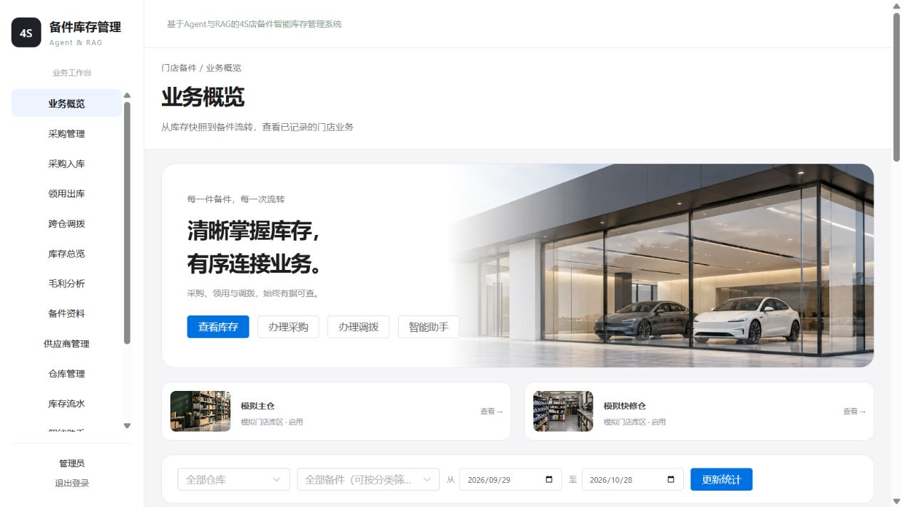
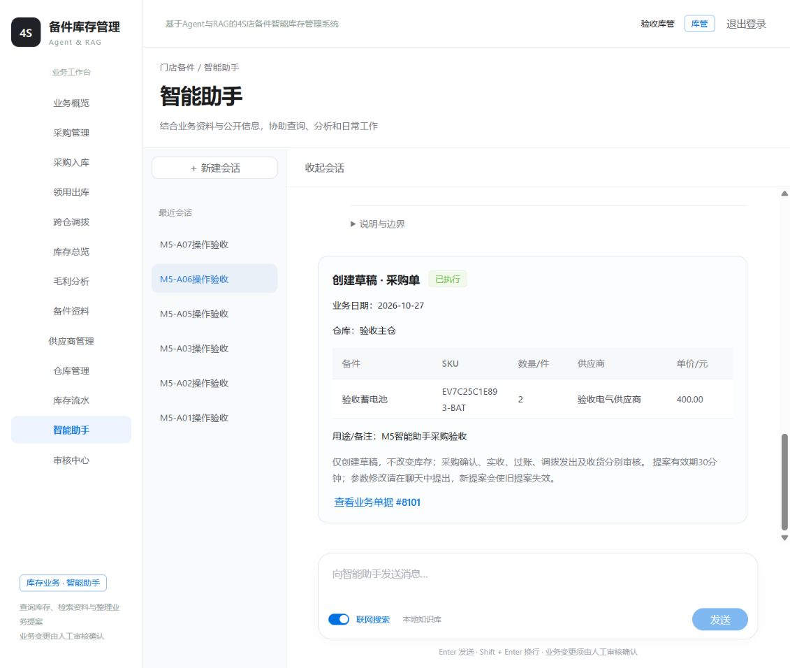
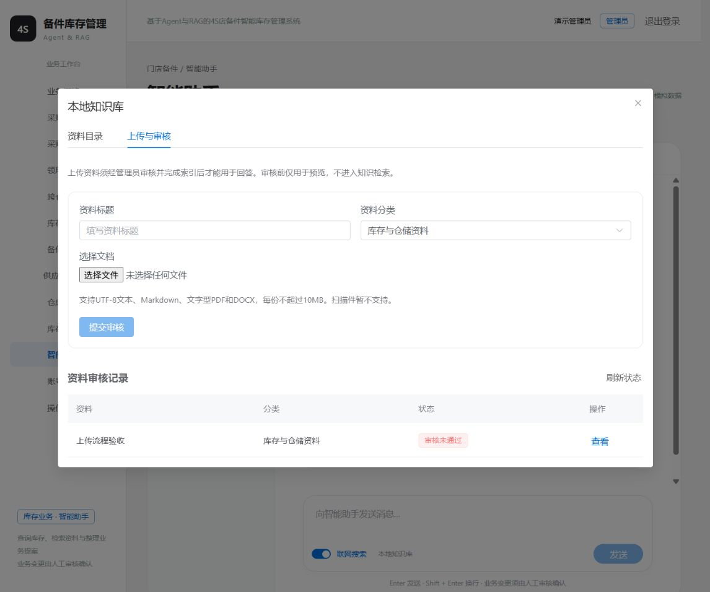
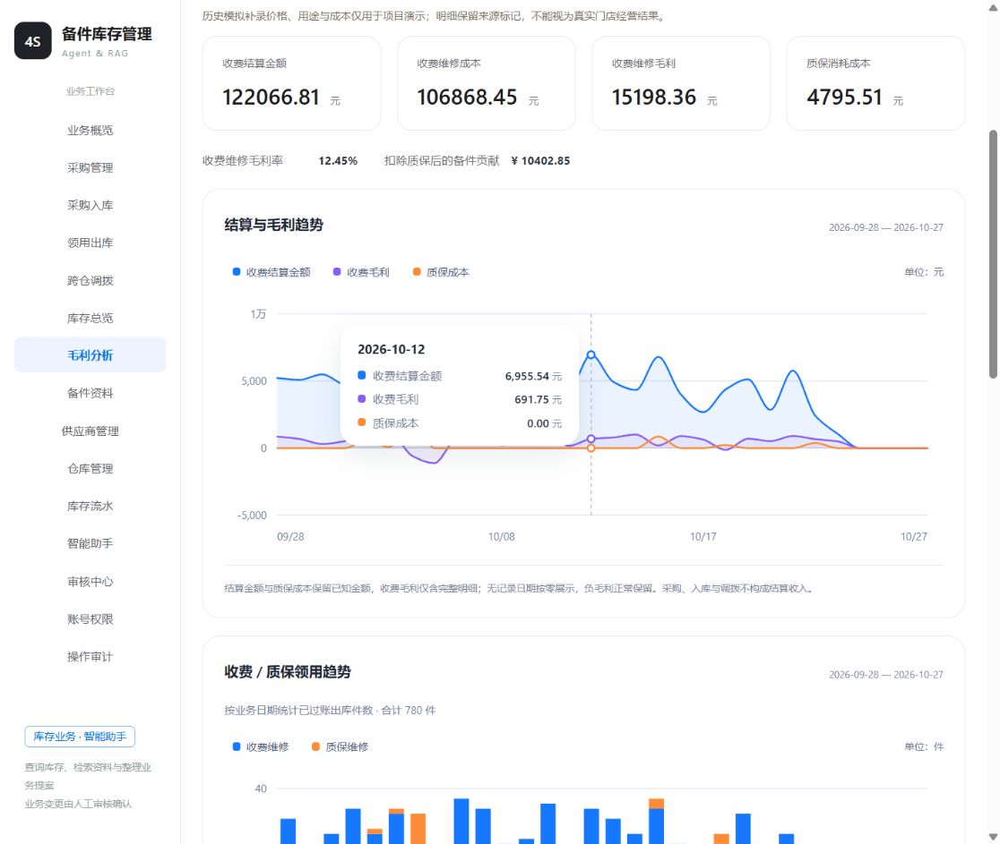
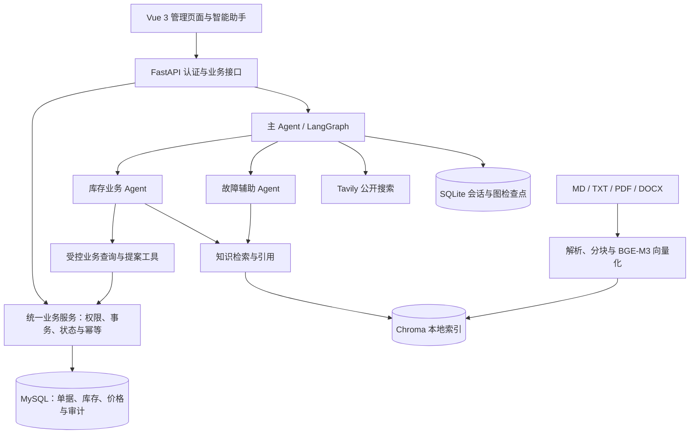
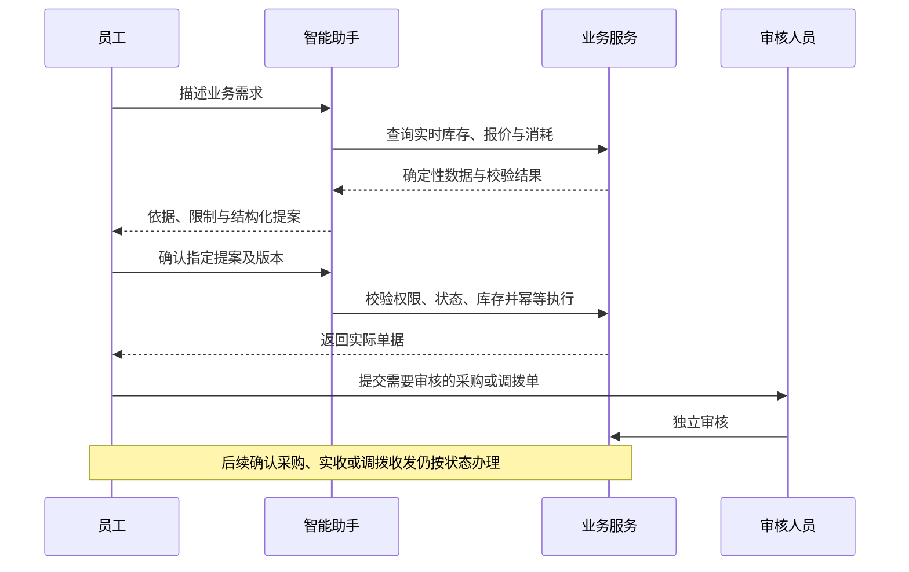

# 基于 Agent 与 RAG 的 4S 店备件智能库存管理系统

融合库存业务、知识检索与多 Agent 协作的全栈项目。员工既可以在管理页面办理采购、领用和调拨，也可以通过智能助手查询实时库存、检索业务依据、分析缺口并生成待确认提案。

**FastAPI · Vue 3 · MySQL · LangGraph · Chroma · BGE-M3 · Tavily**

[功能预览](#功能预览) · [架构与流程](#架构与流程) · [本地运行](#本地运行) · [验证与边界](#验证与边界)

> 项目用于软件开发实践与功能验证。业务记录、供应商、价格和经营数据均为模拟数据，内置配图为 AI 示意素材。仓库提供源码与文档，本地页面地址不是公网在线演示地址。

## 功能预览

### 业务工作台

统一查看库存、采购待收货和调拨在途，按仓库、备件与日期筛选统计。库存关注同时展示目标仓库的采购待收与调拨在途，可筛选计入待到货后仍低于安全库存的备件。



### 库存业务与价格管理

| 模块 | 已实现能力 |
| --- | --- |
| 基础资料 | 48 类通用备件、供应商供货范围、多仓库、独立备件配图与本地图片上传 |
| 采购与入库 | 每条明细先选供应商，再选可供备件；自动带出供货价和合计，支持分批实收 |
| 领用出库 | 区分收费维修和质保维修，保存结算价格与实际库存成本 |
| 跨仓调拨 | 草稿、发出、收货状态；发出扣来源仓，收货增加目的仓，在途独立记录 |
| 库存与流水 | 现有量、可用量、安全库存、采购待收、调拨在途及来源单据追溯 |
| 统一审核 | 采购、调拨与上传知识资料集中审核，业务单据禁止创建人自审 |
| 权限与审计 | 管理员、库管、经理分工；后端校验权限，记录业务操作 |

供应商供货价与门店定价分别维护，历史单据保留价格快照。毛利按实际入库成本与出库结算计算，不将当前供应商报价直接当作历史成本。

### 智能助手与业务提案

支持连续聊天、会话持久化、摘要标题、右键重命名/删除，以及联网公开搜索。主 Agent 调度库存业务 Agent 与故障辅助 Agent，共用受控工具和确认流程。

助手可以查询实时库存、分析消耗、检索制度，准备采购、领用、调拨及后续状态动作的提案。库存不足时会说明缺口，并提供调拨、采购等后续处理选择；必要条件缺失时先追问。



**提案确认与业务审核是两个步骤。** 用户确认后按权限创建或执行相应业务动作；采购、调拨仍遵守独立审核及单据状态要求。创建采购草稿不增加库存，也不代表向外部供应商下单。

### 有来源的知识问答

解析 Markdown、TXT、文字型 PDF 和 DOCX，保留章节、行号、真实 PDF 页码及 DOCX 正文/表格位置。在线 `BAAI/bge-m3` 生成向量，Chroma 本地持久化，结合词项、编号匹配和语义检索返回证据。

本地上传资料经过管理员审核并完成索引后，才能成为助手可检索资料。回答展示实际来源，证据不足时说明限制；故障辅助提供可能故障、检查步骤和换件判断，不把症状直接等同于必须更换。



### 库存与毛利分析

提供入库/领用趋势、分页备件领用排行、收费/质保每日堆叠柱状图、毛利趋势、备件毛利排序和出库成本追溯。图表支持日期悬停提示、系列开关和键盘查看。



截图来自不同阶段的实际操作记录，界面细节以当前源码为准；截图中的金额和数量不代表真实门店经营绩效。

## 架构与流程





库存数量以 MySQL 为准，金额和补货计算由业务代码完成；模型负责理解需求、选择工具与解释结果。库存扣减、流水、状态和幂等结果在同一业务事务内提交；LangGraph 检查点不替代数据库事务。

## 技术与目录

| 层次 | 技术 |
| --- | --- |
| 前端 | Vue 3、Vite、Element Plus、SVG 交互图表 |
| 后端 | Python 3.13、FastAPI、Pydantic、SQLAlchemy、Alembic |
| 业务存储 | MySQL 8 / InnoDB；金额采用 Decimal 与定点字段 |
| 知识服务 | Chroma、在线 BGE-M3（1024 维）、pypdf、python-docx |
| Agent | LangGraph、持久化确认/恢复、受控工具、提案版本与幂等执行 |
| 外部能力 | 兼容 Chat Completions 的在线模型、Tavily 搜索 |
| 验证 | pytest、MySQL 集成测试、Node 测试、固定 RAG/Agent 评测与实际操作记录 |

```text
backend/app/          API、业务服务、模型、RAG 与 Agent
backend/migrations/  数据库迁移
frontend/            Vue 页面、图表、素材与前端测试
data/catalog/       模拟备件、供应范围、价格与安全库存策略
data/knowledge/     库存制度和通用故障资料及来源清单
evals/               固定问题、任务、评测脚本与结果
tests/               业务、权限、事务、检索和 Agent 测试
docs/                设计、接口、验证报告与截图
```

## 本地运行

### 1. 环境与配置

需要 Python 3.13、uv、Node.js（符合 `frontend/package.json` 的版本要求）和 MySQL 8。系统和数据库在本机运行，AI 功能调用在线 API；普通库存业务不依赖模型额度。

在新的项目副本中安装依赖并创建配置；已有 `.env` 时不要覆盖：

```powershell
uv sync --locked
npm --prefix frontend ci
Copy-Item .env.example .env
```

先在 MySQL 中创建项目专用的开发/测试数据库及最小权限账号，再填写本机 `.env`。初始化脚本约束开发库为 `fours_agent_dev / fours_dev`，测试使用独立 `fours_agent_test / fours_test`，应用不使用 root。

| 配置组 | 字段 | 用途 |
| --- | --- | --- |
| 业务数据库 | `MYSQL_HOST / PORT / USER / PASSWORD / DATABASE` | 开发数据库连接 |
| 隔离测试库 | `TEST_MYSQL_USER / PASSWORD / DATABASE` | MySQL 集成测试 |
| 登录 | `JWT_SECRET`、`DEMO_*_PASSWORD` | 本机密钥与三个角色密码 |
| 对话模型 | `API_KEY / BASE_URL / MODEL_ID` | 兼容 Chat Completions 的服务 |
| 向量模型 | `EMBEDDING_API_KEY / BASE_URL / MODEL_ID` | 独立 Embedding 服务，模型为 `BAAI/bge-m3` |
| 联网搜索 | `TAVILY_API_KEY` | 可选公开搜索 |

表中 `/` 为字段缩写，例如向量服务的完整字段为 `EMBEDDING_BASE_URL` 和 `EMBEDDING_MODEL_ID`；以 [.env.example](.env.example) 为准。真实值只写入未提交的 `.env`。

### 2. 迁移与模拟数据

```powershell
.\.venv\Scripts\python.exe -m alembic upgrade head
.\.venv\Scripts\python.exe -m alembic -x database=test upgrade head
.\.venv\Scripts\python.exe -m backend.seed_demo
.\.venv\Scripts\python.exe -m backend.expand_catalog
.\.venv\Scripts\python.exe -m backend.configure_suppliers
```

`seed_demo` 创建模拟账号和基础库存事件；缺失的 JWT 密钥与演示密码生成到本机 `.env`，不使用公开通用密码。账号分别为 `demo_admin`、`demo_storekeeper`、`demo_manager`，密码在各自的 `DEMO_*_PASSWORD` 配置项中。

可选历史、价格与成本补齐步骤见 [模拟数据初始化说明](docs/simulation-setup.md)。这些脚本必须显式执行，不在启动时重置数据库，不要将已有库当作空库重复初始化。

### 3. 知识索引与启动

配置 Embedding 后，在后端未运行时解析并构建索引：

```powershell
.\.venv\Scripts\python.exe -X utf8 -m backend.parse_knowledge --check-only
.\.venv\Scripts\python.exe -X utf8 -m backend.build_knowledge
```

索引构建会将已登记的知识文本发送至配置的 Embedding 服务。同一索引目录仅允许一个进程持有；更换向量模型或维度后需要重建。上传资料走系统内的审核与索引流程。

分别在两个终端启动：

```powershell
# 终端一：后端
.\.venv\Scripts\python.exe -m uvicorn backend.app.main:app --host 127.0.0.1 --port 8000

# 终端二：前端
npm --prefix frontend run dev -- --host 127.0.0.1
```

本机访问：前端 `http://127.0.0.1:5173`，接口文档 `http://127.0.0.1:8000/docs`。运行说明结合本机验收整理，尚未进行全新环境复现，不声称跨平台或生产部署已验证。

## 验证与边界

2026-10-28 发布前重新运行：后端 **332 passed / 1 skipped**，前端 **16 passed**，Vite 构建成功。跳过项为 Windows 符号链接权限条件；上游 Chroma 弃用警告和已有构建分包提示保留。

```powershell
.\.venv\Scripts\python.exe -m pytest -q
node --test frontend/tests/*.test.js
npm --prefix frontend run build
```

业务验证覆盖并发扣减、重复请求、事务回滚、部分收货、调拨守恒、权限、自审限制、价格/成本快照、提案确认与恢复。真实 MySQL、真实模型与 Mock 验证在报告中分别说明；MySQL 测试与 Agent 评测共享测试库，必须串行运行。

RAG 已执行固定问题集的召回、证据覆盖、引用支持及不可回答场景检查，也完成单/多 Agent 的同任务比较。**保留未召回证据与评测集已暴露的限制，不将回归结果宣称为泛化准确率。** 具体数据和统计口径见下列报告。

| 阅读内容 | 文档 |
| --- | --- |
| 实际业务操作、三角色一致性、上传审核引用链路 | [M5 操作验收](docs/m5-operation-verification.md) |
| Agent 工具、提案、恢复与幂等 | [M4 验证](docs/m4-verification.md)、[业务动作边界](docs/agent-action-boundaries.md) |
| RAG 分块、索引、过滤和生命周期 | [RAG 设计](docs/rag-design.md) |
| 固定评测、稳定性修复与质量边界 | [M3/M4 稳定性](docs/m3-m4-stability-verification.md)、[库存召回核验](docs/inventory-rag-recall-verification.md) |
| 角色权限与具体操作 | [操作说明](docs/operation-guide.md)、[演示路线](docs/demo-script.md) |
| 本次提交范围与隐私检查 | [发布检查](docs/github-publication-check.md) |

本地后续 RAG 全链路排查与修复记录见 [2026-10-28 排查报告](docs/rag-chain-audit-20261028.md)，包含来源/解析/索引/召回/上下文/回答的分层检查及剩余限制；它不覆盖上面的首次发布验证记录。

当前范围为单门店、多仓库；不包含真实供应商下单/支付、厂家质保赔付、VIN 解码、具体车型适配认证、退库冲销、部分调拨或生产高可用。质保结算按当前模型为零、保留实际成本，不推断厂家赔付收入；毛利不扣人工、房租等经营费用。

## 隐私与提交范围

仓库不包含实际 API Key、数据库密码、JWT 密钥、本地数据库、会话/图检查点、向量索引、个人上传文件、本机备份、临时简历或开发工具包。配置模板仅含空值或示例；内置业务与评测使用模拟资料。后续提交新增截图、日志或文档时仍需重新检查，`.gitignore` 不能替代内容审查。
