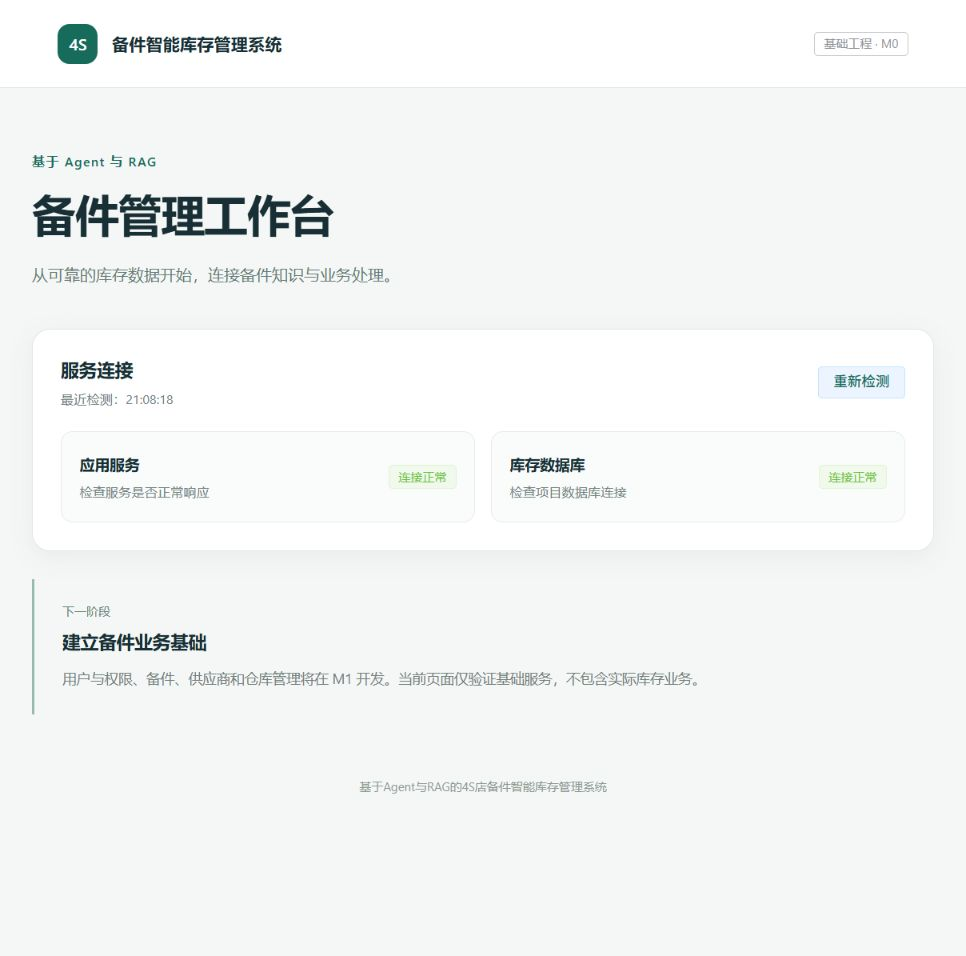

# M0 验收记录

验收日期：2026-10-21。结论：M0 已完成，M1 尚未开始。

## 实际交付

- FastAPI 最小服务：应用存活、数据库就绪检查和自动接口文档；配置读取项目根目录 `.env`，不要求模型配置才能启动。
- Vue 3 + Vite + Element Plus 状态页：真实检测服务与数据库连接，提供重新检测及错误状态，不包含虚构业务数据。
- 开发库 `fours_agent_dev`、测试库 `fours_agent_test`，均采用 utf8mb4。账号 `fours_dev`、`fours_test` 分别只拥有所属库权限，随机密码仅保存在 `.env`。
- Alembic 基线 `0001_m0`，两个库均已到达 head，当前仅包含 `alembic_version`，未创建业务表。
- `.env.example`、Python/npm 锁文件、README、测试和本地 Git 仓库；没有自动提交或发布。

## 验证与结果

除特别标注外，以下命令在项目根目录执行，均实际运行。

| 验证 | 命令或方法 | 结果 |
| --- | --- | --- |
| 后端测试 | `.\.venv\Scripts\python.exe -m pytest -q` | 5 passed，无跳过 |
| 前端构建 | 在 `frontend` 目录执行 `npm.cmd run build` | 成功；Vite 8.3.5 |
| Python 依赖 | `uv pip check --python .venv\Scripts\python.exe` | All installed packages are compatible |
| 锁文件一致性 | `uv lock --check` | 通过 |
| 开发库迁移 | `.\.venv\Scripts\python.exe -m alembic upgrade head` 和 `current` | `0001_m0 (head)` |
| 测试库迁移 | `.\.venv\Scripts\python.exe -m alembic -x database=test upgrade head` 和 `current` | `0001_m0 (head)` |
| 基线回退 | 测试库执行 `downgrade base`，再执行 `upgrade head` | 成功；只在本次新建且仅有版本记录的测试库执行 |
| 账号隔离 | 分别用两个项目账号尝试切换到对方项目库 | 均返回 MySQL 1044；断言通过 |
| 密钥保护 | `git check-ignore` 及对未忽略源文件进行实际密钥字符串匹配检查 | `.env`、环境、依赖和构建目录被忽略；未发现已配置密钥或密码进入源码 |

HTTP 实测均返回200：

- `http://127.0.0.1:8000/api/health`
- `http://127.0.0.1:8000/api/ready`
- `http://127.0.0.1:8000/docs`
- `http://127.0.0.1:5173/`
- `http://127.0.0.1:5173/api/health`
- `http://127.0.0.1:5173/api/ready`

后端测试还覆盖：缺少数据库及模型配置时应用存活但就绪返回503；数据库异常不泄露错误内容；密码特殊字符处理；测试库连接与迁移版本检查。

浏览器实际打开前端页面，确认两项连接正常，点击“重新检测”后检测时间更新且状态正常。截图见下方。

## 边界与交接

本阶段未调用在线模型或 Embedding API，没有修改其既有密钥。此前真实调用记录见 `ai-capability-verification.md`。

当前没有库存业务、用户登录、正式知识库或 Agent 业务工具。账号为本地开发/迁移用途，仅有各自项目库权限，不具有全局管理或授权权限。

服务仅绑定本机地址，前端通过 Vite 代理访问后端。源码未自动提交，未添加远程仓库，未执行云端部署。后续从 M1 的身份、基础数据和期初流水开始，先阅读 `AGENTS.md` 与现有测试。
