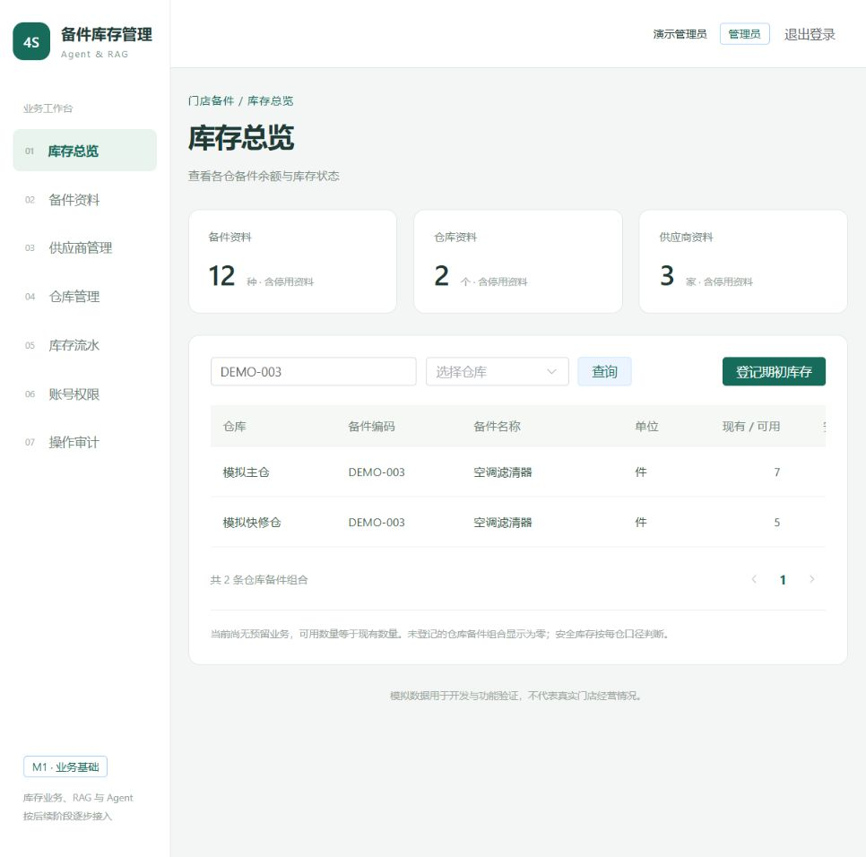

# M1：基础数据与身份验收

验收日期：2026-10-22。项目：基于Agent与RAG的4S店备件智能库存管理系统。

## 已完成范围

FastAPI 提供登录、身份查询、账号新增及角色/启停维护。管理员维护基础资料和账号，并可登记期初库存、查看审计；库管可查询基础资料、库存和流水并登记期初库存；经理只读查询。角色不从客户端参数或 JWT 中取得，每个请求重新读取数据库账号。账号停用后现有令牌在后续请求被拒绝；密码采用 Argon2，JWT 使用独立本机随机密钥，有效期1小时。前端仅在内存保存令牌，刷新需重新登录；退出清除页面会话，不提供单令牌提前吊销。

备件、供应商和仓库支持新增、完整编辑、启停、编码/名称筛选与分页。编码唯一，备件明确计量单位、安全库存、参考单价和默认供应商。参考单价使用 MySQL DECIMAL(12,2)，接口以字符串输出，不作为库存实际成本。已有库存记录的备件禁止修改 SKU 和单位；不提供删除历史关联资料的接口。

期初登记支持一仓多明细、正整数数量、日期与启停校验。一次有效登记同时写入期初单、明细、余额、流水和成功操作审计。余额按仓库/备件唯一，已有余额组合禁止再次初始化。UUID 请求标识与规范化参数摘要绑定；相同操作人的相同请求重放返回原单，不增加流水，不同参数或操作人返回409。库存和流水不提供直接修改接口。

应用连接明确使用 READ COMMITTED，并对期初仓库及按备件 ID 排序的资料加锁。仓库锁串行处理本仓首次建账，唯一约束防止重复余额和请求；参数校验或后续明细冲突时整体回滚。只配置应用连接隔离级别，没有修改 MySQL 全局配置。

Vue 页面已接入真实接口：登录、库存总览、备件资料、供应商、仓库、库存流水、账号权限和操作审计。基础资料选择器按分页取全当前小规模本地资料；数据规模扩大时再改为远程搜索。当前无预留流程，可用量等于现有量，安全库存按每仓判断；未登记组合显示零，同时标记“未登记”。时间存储为 UTC，页面转换为本机时区。

## 数据库与模拟数据

开发库和测试库均从 `0001_m0` 升级到 `0002_m1`。新增9张业务表：`users`、`suppliers`、`warehouses`、`parts`、`opening_documents`、`opening_lines`、`stock_balances`、`stock_ledger`、`audit_logs`。`alembic check` 对两个库均未发现待迁移差异。

模拟数据来源为项目自建固定清单 `backend/seed_demo.py`，没有使用真实门店、客户或厂家资料。固定业务日期2026-10-01，不随机生成业务数量；随机值仅用于本机认证凭据。首次导入含3类演示账号、3家供应商、2个仓库、12种备件、2张期初单、18条正数量明细/流水。零库存由未建账组合展示，不伪造零数量明细。

脚本仅允许开发库及其专用账号，显式执行，不随启动运行。按唯一编码补充缺失资料，固定请求标识保证期初重放安全；不清库、不恢复被修改的资料、不重置已有账号密码。实际重复运行并对比业务表记录数，没有新增记录或重置余额。

浏览器正向验收新增了期初单 #3：模拟主仓、`DEMO-003` 空调滤清器、7件、业务日期2026-10-22、备注“浏览器验收：模拟期初库存”。因此当前开发库为3张期初单、19条明细、19条余额和19条流水；12种备件×2个仓库在总览展示24个组合。实际逐项核对余额与流水合计完全一致，流水与来源明细的数量、备件和仓库无不匹配。人工验收记录已保留，重复运行导入脚本不会删掉或重置它。

账号为 `demo_admin`、`demo_storekeeper`、`demo_manager`；随机密码只保存在未提交 `.env` 的对应 `DEMO_*_PASSWORD` 字段。接口、文档和日志不记录明文密码或令牌。测试使用独立前缀数据，结束后仅清理本轮数据，开发库不参与测试清理。

## 实际验证

```powershell
.\.venv\Scripts\python.exe -m alembic upgrade head
.\.venv\Scripts\python.exe -m alembic -x database=test upgrade head
.\.venv\Scripts\python.exe -m backend.seed_demo
.\.venv\Scripts\python.exe -m pytest -q
.\.venv\Scripts\python.exe -m alembic check
.\.venv\Scripts\python.exe -m alembic -x database=test check
npm.cmd --prefix frontend run build
```

后端10项测试通过，无跳过；其中5项为 M0 基础与隔离测试，5项为 M1 集成测试。M1 用例内部覆盖未登录和伪造/过期令牌拒绝、角色越权、账号停用与变更生效、密码哈希和校验错误不回显密码、编码唯一性、金额/数量校验、停用资料拒绝入账、重复请求与参数冲突、同仓重复建账拒绝、失败后整单回滚，以及并发同请求、并发竞争同一库存组合、跨仓复用同一请求标识。核心事务验证均在真实 MySQL 测试库执行。

前端 Vite 构建通过。浏览器实际验证管理员登录、原值保存备件、经理登录及只读入口、备件第二页结果、编码筛选并复位页码、期初单 #3 正向入账及对应流水、账号权限列表和成功操作审计。接口使用本机8000服务，页面通过5173代理访问，没有用静态数据冒充接口结果。



## 交接与范围边界

启动方式、登录配置和模拟导入方式见根目录 README。当前本机服务地址为前端 `http://127.0.0.1:5173`、后端文档 `http://127.0.0.1:8000/docs`。两者为本地开发服务，没有生产部署。

本阶段审计记录成功登录和成功提交的变更，失败业务请求随事务回滚；尚无独立的安全事件日志、密码找回、在线模型业务调用或真实经营指标。没有实现采购、出入库、调拨、库存消耗分析、正式知识库和 Agent。

下一阶段 M2 基于现有权限、业务事务和流水继续建设采购/收货、领用出库、跨仓调拨及统计；届时按实际单据类型扩展流水来源，并验证扣减并发、状态流转和调拨守恒。本次未提前生成 M2 空模块。
