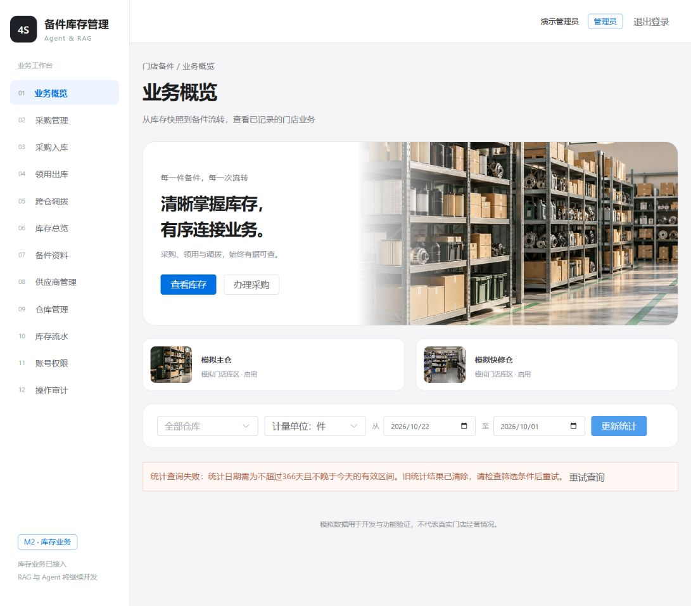
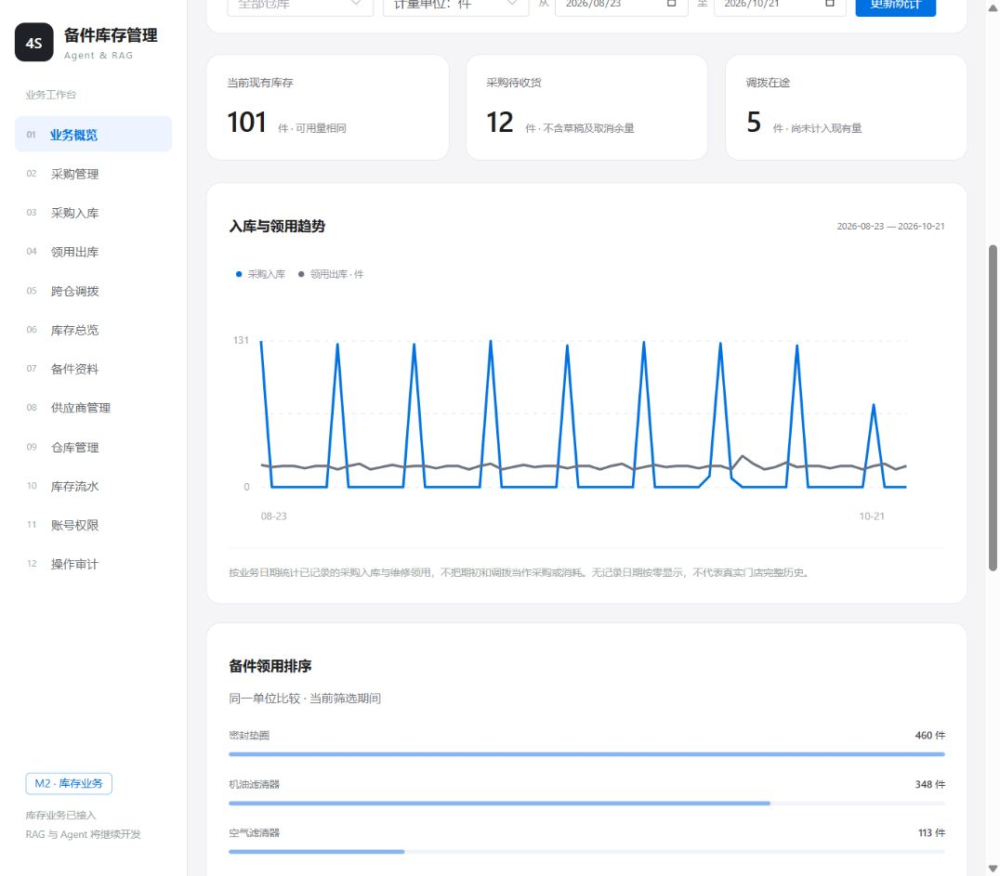

# M2 收尾：查询错误状态与60天模拟历史

日期：2026-10-22。范围仅为 M2 收尾，没有实现 M3/M4，没有创建 Git 提交。

## 查询失败与恢复

修改 `frontend/src/` 下的 `StatisticsPanel.vue`、`CatalogPanel.vue`、`InventoryPanel.vue`、`DocumentsPanel.vue`、`AccountsPanel.vue`、`AuditPanel.vue` 及 `App.vue`。

查询失败后持续显示错误原因与重试按钮，清除旧的列表、总数或统计数据；不把失败显示为正常空结果。提示保留到本次查询成功。列表与统计只接收最新一次请求的结果，防止旧请求覆盖新查询状态。单据详情有独立错误提示及重试入口，失败时关闭旧详情。业务写入失败仍沿用原有提示和幂等重试流程，没有改变库存业务事务。

浏览器实际验证：先正常显示统计，再将开始日期设为2026-10-22、结束日期设为2026-10-01，后端返回422，页面持续显示错误且移除旧图表、数值及排序；修正为2026-08-23至2026-10-21并点击“重试查询”，错误解除，历史图表恢复。另以超过100字符的资料查询触发422，旧卡片和总数清除；清空条件后重试，恢复12种备件。没有停止服务或更改数据库配置。没有逐个对所有页面注入网络故障。



## 固定模拟历史

新增导入程序为 `backend/seed_history.py`，只允许 `fours_agent_dev` / `fours_dev`，不在启动时执行，不重置账号、资料、期初或已有单据。调用现有 `create_document`、`transition` 和 `receive_purchase`；单据、余额、流水、成功审计及幂等请求在同一事务内提交。若必要演示资料缺失、停用或单位已改变，整体停止。

- 完整模拟领用区间：2026-08-23至2026-10-21，含首尾60天；两个仓库每天均有已过账领用，12种备件均覆盖。
- 时间基准固定，不随重跑日期滚动。业务日期为模拟历史，创建/审计时间为实际导入时间；不回写原有期初日期。
- 每7天汇总一次采购及实际入库，共9批，末批4天。保养件、油液、综合件按固定3/5/7天交期提前采购，因此最早采购业务日期为2026-08-16。
- 每个备件的领用周期、基础数量在 `INTERVALS`、`BASE_QUANTITIES` 中明确列出，使用固定取模规则产生小幅变化；快修仓用量适当减少。无随机余额或模型生成数量，采购单价来自 M1 固定 `PARTS` 清单。
- 每批采购实收量恰好覆盖该批计划领用，累计历史收发对每个仓库备件组合净变动为零，保留原低库存、零库存及在途演示。该人为平衡是演示约束，不能用于宣称真实需求预测或供应链策略效果。
- 请求标识通过独立的 v1 命名空间和仓库、日期、业务动作确定；重跑只回放原结果。不依赖当前参考单价或默认供应商字段生成不同参数。
- 完整性仅覆盖声明的固定区间与演示备件、仓库；未来日期、新增资料不自动具有完整历史。

新增228张单据，其中54张采购单、54张实际入库单和120张已过账领用单，新增880条库存流水。原15张业务单据、32条流水及期初和资料均保留。开发库最新快照为243张业务单据、1102条业务明细、912条库存流水及24条余额。原先未建账的5个仓库备件组合因发生历史收发而增加零余额记录，不能再登记期初。

现有库存仍为件101、桶67、瓶4、套26；调拨在途仍为件5，采购待收仍为件12。不同单位不混加。后续人工操作会改变该快照。



## 验证命令与结果

```powershell
.\.venv\Scripts\python.exe -m pytest -q tests/test_history.py
.\.venv\Scripts\python.exe -m pytest -q
.\.venv\Scripts\python.exe -X utf8 -m backend.seed_history
.\.venv\Scripts\python.exe -X utf8 -m backend.seed_history
.\.venv\Scripts\python.exe -X utf8 -m backend.check_inventory
.\.venv\Scripts\python.exe -X utf8 -m backend.check_inventory --test
npm.cmd --prefix frontend run build
```

新增的真实 MySQL 测试覆盖60日领用日期完整、余额与流水一致、原有库存数量保留、按业务日期重建时库存非负、重复导入不增加单据/流水/请求/审计，以及统计接口返回60日领用趋势。测试只使用隔离测试库中的本轮唯一前缀数据，结束后清理。

本轮全部16项后端测试通过、无跳过，前端构建通过。开发库余额/流水、单据来源和全仓现有加在途守恒检查通过；测试库清理后对账通过。额外比较导入前已有9张相关表的原记录哈希，均一致；新增历史24个仓库备件组合净变化均为零。重跑导入后相关业务表、幂等请求及审计行数不变。开发库全部流水按业务日期重建，无历史负库存。

下一阶段仍为 M3。后续计算最近30个完整自然日消耗时，先确认查询窗口位于覆盖区间，并区分模拟资料与真实业务事实。本次没有新增消耗预测、补货规则服务、RAG 或 Agent。
