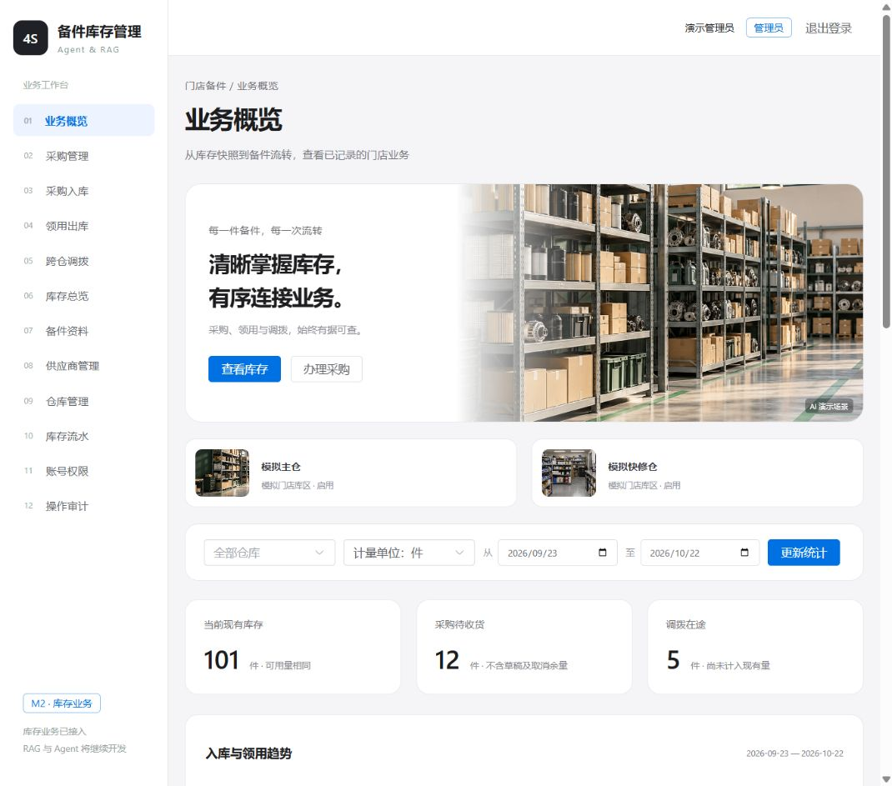
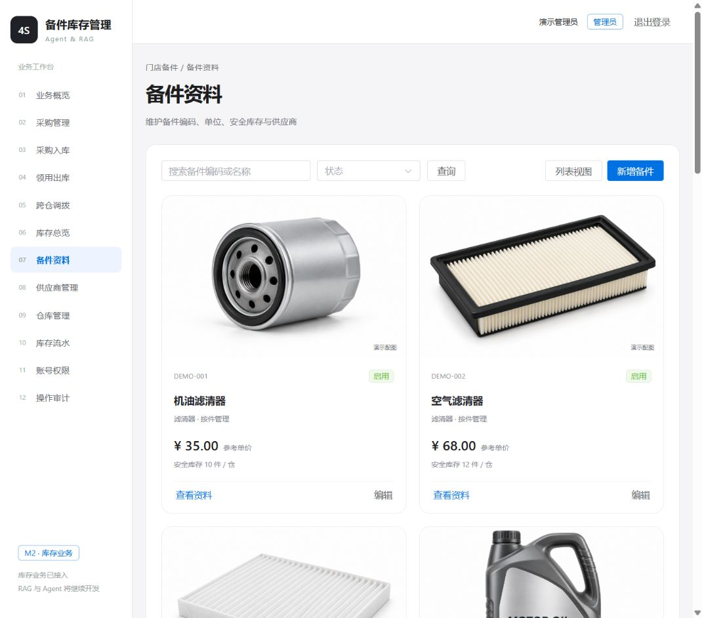
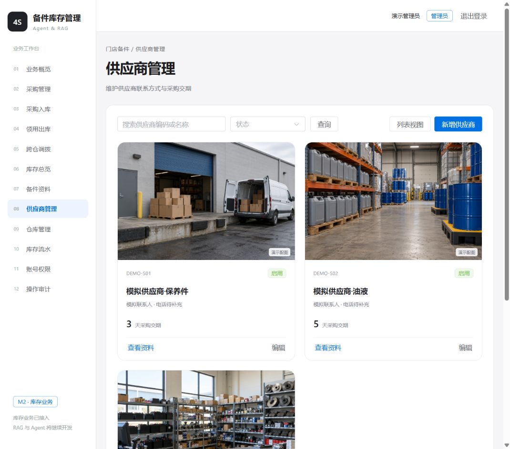
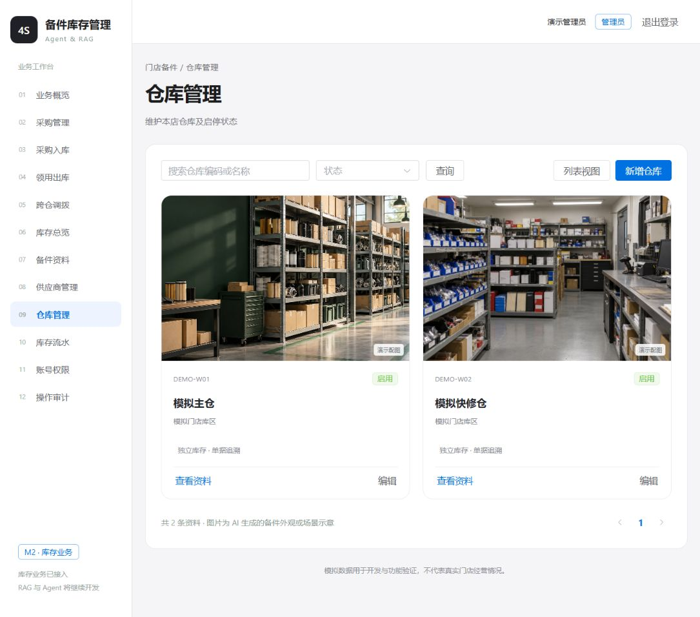

# M2：库存业务闭环与图片界面验收

日期：2026-10-22。项目：基于Agent与RAG的4S店备件智能库存管理系统。

本文保留 M2 首次验收时的测试数量与数据快照。后续查询错误提示与60天模拟历史的最新结果见 [M2 收尾记录](m2-closeout.md)。

## 实现与状态语义

采购单使用草稿、已确认、部分收货、已完成、已取消状态。创建或确认不增加库存；每次实际收货创建独立入库单，引用对应采购明细，同时增加余额和流水、累计已收数量并更新采购状态。服务端拒绝跨单收货和超量收货。采购取消只终止未收余量，已经收到的实物、入库单和流水保留。

领用单支持草稿、已过账、已取消；草稿不占用库存，过账时重新校验并扣减可用数量。调拨支持草稿、已发出、已收货、已取消；整单发出扣来源仓并计入目标方向在途，整单收货增加目标仓现有量并结束在途。仅调拨草稿可取消，首版不支持部分调拨、发出后撤回、已过账单据直接撤销或删除。草稿填写错误采用取消后重建，未实现草稿编辑页面。

管理员和库管可办理上述业务，经理只读。前端按钮由角色决定，后端每次独立检查权限。明细数量为正整数，金额为 Decimal/DECIMAL，单价和单据金额以字符串输出；日期、同仓调拨、重复明细、停用资料、库存上限及状态动作均校验。

业务集中在 `backend/app/documents.py`，页面接口与演示导入调用同一服务，后续 Agent 工具应继续复用。当前没有实现 Agent 或 RAG。

## 事务、流水与迁移

创建/确认/取消/收货/出库/调拨均使用 UUID 请求标识，绑定动作、参数摘要、操作人与结果单据。相同请求重放返回原结果；不同参数、动作或操作人返回409。请求结果、单据状态、余额、流水和成功审计同一事务提交；失败整体回滚。

使用 READ COMMITTED；先锁业务单据，再按仓库 ID、备件 ID 的稳定顺序锁定关联数据。首版按仓库串行办理库存变化，余额扣减仍在锁内检查。并发吞吐扩大时再依据实测缩小锁范围，当前没有引入队列或分布式锁。页面在请求结果不明确时保留原请求供重试，避免超时后直接生成新请求重复收货。

迁移 `0003_m2` 保留已有 M1 期初记录，在原9张业务表上增加 `documents`、`document_lines`、`operation_requests`。库存流水扩展业务明细、事件、业务日期与实际操作人，并约束期初明细和业务明细两种来源恰有其一。同一业务明细/事件唯一，避免重复发出或收货流水。已被业务明细引用的备件不能再修改编码和计量单位，资料仍采用停用而非删除。

两个数据库均升级至 `0003_m2`；`alembic check` 对开发库、测试库均无待迁移差异。M2 空测试表曾完成回退至 M1 再升级检查；没有对含业务记录的开发库回退。回退脚本在发现 M2 单据时会主动拒绝直接删除业务表，不能将空表回退成功解释为已有业务可无损降级。

## 页面与统计

新增采购管理、采购入库、领用出库、跨仓调拨页面，支持列表状态/仓库筛选、分页、单据明细查看及相应状态动作。采购明细可查看实收数量与金额，实际入库单可回查采购，采购可查看关联入库单。

库存总览分别返回现有/可用、采购待收、调拨在途，查询未建账组合时显示零和未建账标记。尚无预留流程，可用量等于现有量。流水展示期初、采购入库、领用、调拨发出/收货来源及数量正负、业务日期、实际操作人与时间。

业务概览提供按仓库、计量单位、日期范围筛选的入库/领用趋势与领用排序、当前库存快照及启用组合低库存。不同计量单位不混加；现有、待收与在途是当前快照，日期范围只约束趋势和排序。无业务记录的日期按零条已记录数量展示，不代表真实经营历史完整，也不用于声称需求预测或完整30日消耗分析已完成。

## 图片与视觉调整

备件采用无品牌、无树叶和绿植的白底单品摄影风格，每个 DEMO SKU 对应独立图片：12种备件共12张。两个仓库分别使用主仓货架、快修备件区场景，三家供应商分别使用配送装卸区、油液仓储区、综合配件柜台，共5张不同图片。已逐张查看17张最终素材，核对单品主体和场景区分；实际检查17个文件内容哈希均不同、文件存在、12个 SKU 映射与固定清单一致。

资料默认卡片展示，支持列表切换、图片预览和编辑时选择已有配图；库存、单据明细和低库存关注使用同一绑定。未配图或未知图片键显示“暂无图片”，不再用分类组合图代替具体备件。图片键按备件/仓库/供应商类型限定，不接受任意路径或远程 URL；首版不包含任意文件上传。

界面为浅灰白底、克制蓝色操作色。横幅只在整体宽度40%到60%之间做左右渐变，过渡中点为50%；文字层没有独立白色渐变块，顶部、底部、右侧没有渐变。浏览器截图检查了横幅和实际卡片。全部图片标为 AI 演示配图，不能声称为真实厂家或供应商照片。最终路径和完整提示词见 [素材说明](m2-image-assets.md)。

## 实际验证与开发数据

```powershell
.\.venv\Scripts\python.exe -m alembic upgrade head
.\.venv\Scripts\python.exe -m alembic -x database=test upgrade head
.\.venv\Scripts\python.exe -m backend.seed_m2
.\.venv\Scripts\python.exe -m pytest -q
.\.venv\Scripts\python.exe -m alembic check
.\.venv\Scripts\python.exe -m alembic -x database=test check
npm.cmd --prefix frontend run build
.\.venv\Scripts\python.exe -X utf8 -m backend.check_inventory
.\.venv\Scripts\python.exe -X utf8 -m backend.check_inventory --test
```

后端15项测试通过、无跳过，包括 M0 的5项、M1 的5项及 M2 的5项。M2 用例在真实隔离 MySQL 中覆盖部分收货与完成、跨单/超量收货拒绝、取消未收余量、Decimal 金额、非法状态、权限与图片类型校验、重复请求、出库后续明细失败的整单回滚、并发出库防止超卖、在途与收货守恒、并发重复调拨收货，以及统计筛选。测试按本轮唯一前缀清理数据，结束后测试库业务表为空，没有清理开发库。

前端 Vite 构建通过。浏览器实际完成管理员登录、采购单 #14 草稿录入与确认、密封垫圈1件实收生成入库单 #15、采购更新为已完成，并将已有领用草稿 #13 过账出库1件火花塞；核对了调拨单 #10 的在途明细和收货入口、备件图片卡片、不同供应商图片及业务概览。调拨实际收发与并发由上述 MySQL 测试验证，浏览器保留了原在途演示单供用户操作。

`backend/seed_m2.py` 显式生成固定日期和价格的演示事件，不随机填余额，不重置已有 M1 数据和人工操作。两次运行未重复生效；浏览器验收后又对比全部业务表行数与余额重复运行，结果保持不变。M1 浏览器增加的主仓 DEMO-003 的7件期初库存也保留。

验收后的开发库为19条余额、32条流水、15张 M2 业务单据。逐仓/备件余额与流水合计一致，流水的备件、数量和仓库与来源单据一致；全仓现有数量加调拨在途按单位守恒。当前现有为件101、桶67、瓶4、套26，在途为件5。上述是模拟数据当前快照，人工继续操作后可变化，不能视为真实业务指标。

源码和前端构建文件已扫描实际凭据值，未发现密钥、数据库密码、演示密码或 JWT 密钥泄露；真实配置和本地依赖/构建目录继续由 Git 忽略。









## 交接

本地前端仍为 `http://127.0.0.1:5173`，后端文档为 `http://127.0.0.1:8000/docs`。新增配置项为零，沿用 M1 数据库账号与 JWT。登录、启动、完整导入顺序见 README。没有部署到生产、连接真实厂家系统或执行外部采购。

下一阶段为 M3 正式 RAG：登记演示制度资料及版本，形成可重建索引、带来源引用的检索问答与固定评测。此次没有提前实现 M3/M4 空模块。
