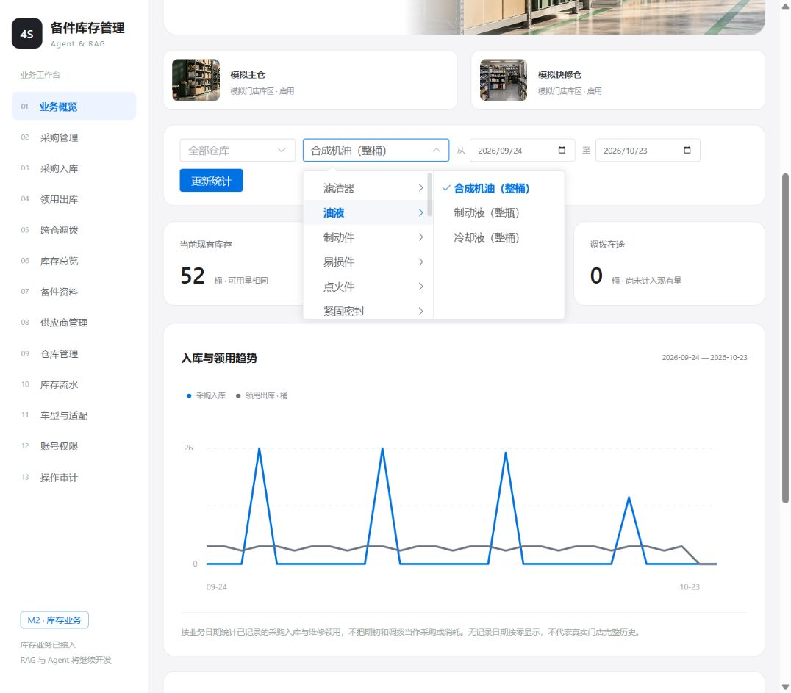

# M3.2 最小向量索引与检索验收

日期：2026-10-23。运行环境为项目`.venv`的Python 3.13、Chroma 1.5.9；使用用户已配置的硅基流动普通版`BAAI/bge-m3`在线接口，没有下载本地模型、调用对话模型或写业务库存。本次同时处理用户追加的统计备件筛选需求，见文末。

## 已交付内容

`backend/app/ai.py`读取独立Embedding配置，显式HTTPX请求；检查返回index、数量、1024维、有限值、非零和模型标识。构建每批最多16条，各网络操作30秒超时，整个构建最多一次瞬态错误重试；查询10秒且不自动重试。认证、模型和响应校验错误不重试，上游正文不回显。重试时总token用量置为不可用，不用成功请求的用量冒充全部成本。

`backend/app/retrieval.py`在受控本地路径使用操作系统独占锁；先建新代次、显式传向量写两个cosine集合，使用`embedding_function=None`，校验ID集合、数量与配置，关闭重开Chroma后再原子切换活动指针。记录来源/模型指纹、解析版本和派生文件哈希；相同输入复用，不因解析核验日期改变而重嵌入。失败保留失败代次，活动指针不发布半成品。同ID同版本正文改变时拒绝覆盖。

查询先核对当前来源、知识域与来源资格，在Chroma查询前按允许文档ID过滤。当前默认`released_only`没有可用来源，直接返回而不请求Embedding；显式`draft_preview`才检索待复核正文。故障检索返回完整症状单元，额外携带8个公共规则章节作为上下文，它们不算症状向量召回命中。返回真实章节和行号，无伪造页码，无置信概率或自动换件结论。来源在查询期间改变时丢弃结果。

本阶段只有`backend.build_knowledge`、`backend.query_knowledge`两个CLI，不开放未认证的HTTP接口。普通库存后端不打开Chroma，可以持续运行；所有CLI索引操作使用同一独占锁。后续M3.5接入知识API时必须将锁接入后端生命周期，形成离线构建与索引服务互斥。没有提前新增空API或前端知识页面。

## 真实在线构建与恢复

```powershell
.\.venv\Scripts\python.exe -X utf8 -m backend.build_knowledge
.\.venv\Scripts\python.exe -X utf8 -m backend.build_knowledge
.\.venv\Scripts\python.exe -X utf8 -m backend.query_knowledge "库存制度现在可以执行吗？" --knowledge-base inventory_policies
```

首轮生成代次`024e24f1df764bc49ef1a79c658d4dc6`，指纹`728f2493ea3763e43b2fe21697d9e86691256f513d85084033950d36a3b52e33`。14份MD/TXT、155条向量、60个父上下文；库存132条、故障23条，5份PDF/DOCX仍未支持。真实HTTP请求11次、155段输入、0重试，上游返回27671个total_tokens；本机该次构建计时4.462秒，不作为吞吐承诺或生产性能指标。第二轮返回`reused=true`、0次Embedding请求、相同代次。

本地文件位于已忽略的`data/chroma/rag/`：`active.json`、`owner.lock`和`generations/<generation_id>/`。代次内含generation.json、sources.json、units.jsonl、contexts.jsonl及chroma目录。不回写原生清单的批准状态或index_status，不修改M3.1不可变解析导出。

构建进程退出后，在独立Python进程重开活动代次完成15次真实查询；默认范围另核验为`no_eligible_documents`、0次请求。自动测试也用独立进程重开本地Chroma；独占锁的第二进程被拒，原进程释放后可重新取得。

## 开发集向量基线

原始可核查记录：[检索运行结果](../evals/runs/m3-2-dense-development-2026-10-23.json)，保存输入文件哈希、索引指纹、查询、top-5片段、距离、版本及扩展上下文ID。仅使用development输入，未读取验收题进行调参，未生成回答。15次真实查询返回390个total_tokens，0重试；未查询价格或虚构费用。

| 知识域 | 已运行开发题 | 原始top-5证据组命中 | 预期证据组全部命中的问题 | 未运行 |
| --- | --- | --- | --- | --- |
| 库存制度 | 7 | 9/13 | 5/7 | 5题依赖PDF/DOCX |
| 通用故障 | 8 | 9/9个症状证据组 | 8/8 | 验收集未运行 |

命中口径为预先规定证据组的覆盖，不是全部相关片段的Recall，也不是回答正确率。公共规则由服务端补充，不给症状召回加分。库存DEV-INV-01未召回指定发布条款；DEV-INV-08召回领用制度但未覆盖指定退库/调整条款的三组证据。保留这些失败，不改问题、不伪造命中；M3.4组合检索应在同一条件下比较。父上下文扩展后，本轮完整问题命中数未提高。

## 自动验证

```powershell
.\.venv\Scripts\python.exe -X utf8 -m pytest tests/test_retrieval.py tests/test_knowledge.py tests/test_m0.py -q
.\.venv\Scripts\python.exe -X utf8 -m pytest tests/test_m2.py -q
```

前端构建在`frontend`目录执行：

```powershell
& 'D:\DevTools\nodejs\node.exe' node_modules/vite/bin/vite.js build
```

第一条76项通过、1项跳过，其中新增索引/HTTP验证35项。跳过沿用M3.1的Windows符号链接权限限制。覆盖响应乱序/维度/非数值/零向量、脱敏错误、有限重试及共享预算、缺密钥、模型与端点不兼容、跨进程恢复/锁、构建失败保留旧指针、重复构建、撤回过滤、源文档在构建/查询期间变化、同版本改正文拒绝、快照改写及Chroma记录缺失。

HTTP协议测试使用MockTransport；本地索引测试使用明确模拟向量和真实持久化Chroma，不计作模型质量结果。前一节的15次查询和155条构建则是真实在线BGE-M3，两类证据分开记录。Chroma在读取显式空Embedding配置时产生SDK的legacy embedding function config弃用提示；操作均成功，未因此启用默认Embedding或改动依赖。

## 追加：统计页按备件分类筛选

业务概览移除计量单位选择，改为“分类 → 具体备件”级联选择，直接输入名称可跨分类搜索。沿用备件现有category，缺分类归入“未分类”；未改写业务资料分类。默认选择目录首项，用户可以换选，再点击“更新统计”。服务端接收part_id，校验备件存在并从资料取单位；现有、采购待收、在途、趋势、低库存和分仓数据均受同一part_id约束。原unit参数保留给旧接口调用方，页面不再要求用户选单位。

真实隔离MySQL的6项M2测试通过，新增用例验证同单位的不同备件不会混入、套/件单位自动带出、各统计分支一致过滤、非法/不存在ID被拒。前端构建通过，新增Cascader后产物544.44kB，Vite给出超过500kB的分包提示；本次未为小范围筛选改动重构整个前端。

实际浏览器验证“油液 → 合成机油（整桶）”后统计显示桶；输入“点火线圈”能定位、选中并查询，对应件及零库存正确显示。已用本机演示管理员恢复工作台。仅重启已核实的本项目8000端口进程，不结束其他程序；未修改开发库存或提交Git。



## 尚未完成与交接

M3.3解析两份PDF、三份DOCX后再扩展到19份资料和预期242个单元。目前源文件任何改变会保守阻止整个旧代次，不提供M3.4的按来源部分可用服务；没有自动清理历史代次、混合检索、重排序、问答API/页面、实时库存工具或Agent。当前知识均待核准，不能称为已批准企业制度。完整48题库存/30题故障的回答与Agent验收尚未运行，M3整体仍未完成。

本次未改依赖锁、数据库迁移或.env。下一步按M3.3锁定项目pypdf/python-docx，验证原生正文、表格顺序及PDF实际页码，不能用Markdown母稿替代原生解析。
