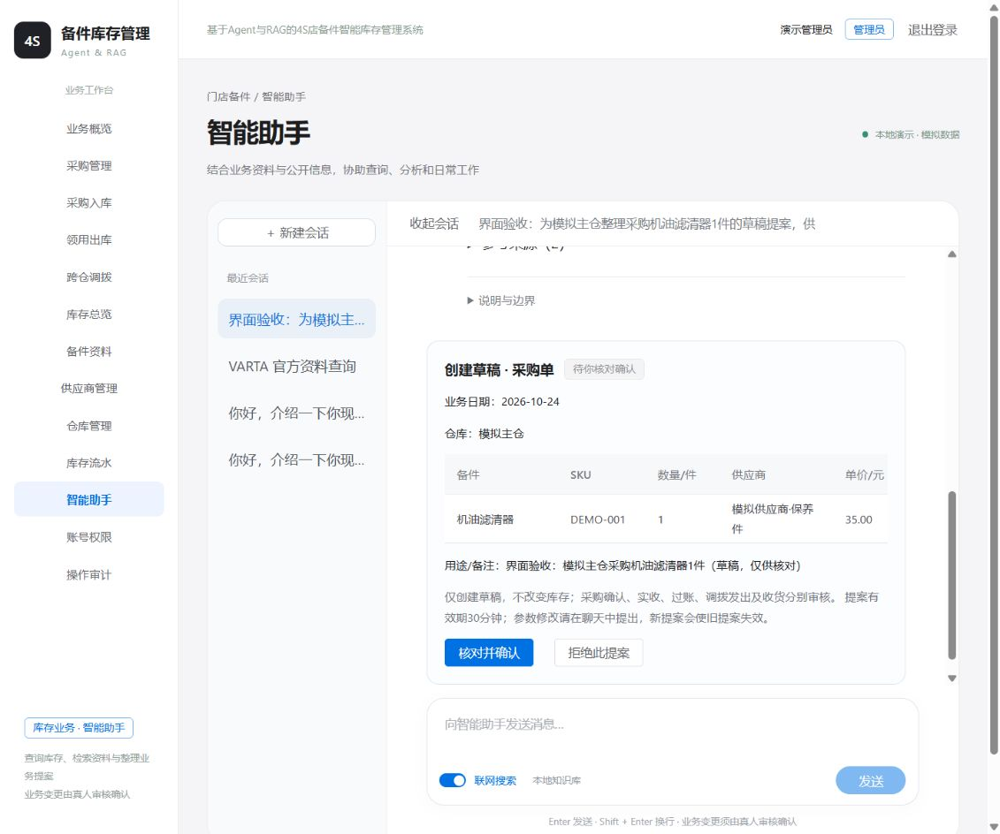

# M4 受控业务协作与单/多 Agent 开发对比

2026-10-24，按用户明确授权实施。未提交Git。M3.6首次基线先完成并保存，随后实施工具、提案、确认和执行，再接入集中调度的三个角色，最后用同题比较。

## 实际实现

主Agent在统一聊天入口理解上下文、选择一般资料回答或库存业务/故障专业Agent。两个专业Agent通过原生Chat Completions function calling选择受限工具，故障Agent没有库存查询或提案工具。组合请求先处理故障子任务，再处理库存业务子任务，来源引用随交接传递，保留RAG服务端绑定的原始回答与逐部件状态，不让专员重复改写成无来源结论。

三个角色可共用当前DeepSeek在线模型，不新增本地模型、微服务、队列或多进程Chroma。单Agent对照使用同样的工具、资料与模型，一个角色处理全部任务；生产入口默认多Agent，单Agent仅为本轮对照运行路径，不新增用户界面模式开关。

统一工具为catalog、stock、history、documents、replenishment、knowledge、web_search、prepare_proposal、finish。所有输入经Pydantic校验，身份来自服务端；没有任意SQL、shell、文件或任意URL工具，也没有模型可调用的execute/approve工具。历史消耗只计已过账领用，完整覆盖必须有显式模拟计划来源；不足时返回限制，不能仅凭首尾记录宣称完整30日。目标库存及可调余量使用Fraction/ceil确定性计算，同轮多个目标共享来源余量记账，不重复承诺同批库存。

消息总截止120秒；主Agent一次调度，每个专员最多6模型回合，全任务最多12工具调用。单个模型请求30秒、Embedding和搜索保持自身限制，不隐性重试。工具轨迹保存于本机会话结果；运行日志仅记角色、动作、必要数字ID、结果与耗时，不打印密钥。角色与知识域的权限由服务端再次限制。

故障检索可用改写后的子任务检索，但检测记录出处始终对照原始用户消息；模型的改写不成为用户已检测或批准的证据。诊断结果不能自动证明具体商品适配、数量或领用授权。

## 提案、确认与恢复

迁移0006_agent仅新增agent_proposals表，两套项目数据库均升级并通过alembic check；无原表回退、清空、重新种数据。

提案包含服务端ID、不可原地修改的版本1、所有者、会话/轮次、动作、完整参数、业务快照、30分钟期限与执行结果。每轮至多一个业务提案；新轮生成不同提案后，原会话待确认提案变为superseded。聊天所说“已批准”不产生执行权限。确认接口只接受version和approved，不能夹带改后的参数或operator_id。

支持创建采购/领用/调拨草稿，及采购确认、实收入库、领用过账、调拨发出/收货和当前允许的取消动作。每项都是独立提案和真人确认，创建草稿不联动后续状态。未确认仅写提案及聊天/检查点，不写documents或stock_ledger。

LangGraph review节点interrupt等待按钮决定，独立execute节点复核当前身份、角色、版本、有效期、启停/供货范围、单据和库存快照后，调用documents.py。稳定请求键从提案ID/版本派生。业务单据/库存/流水/幂等记录与提案executed结果同一MySQL事务提交；SQLite图检查点与业务事务分开。提交后检查点失败，再恢复会返回已提交的同一结果，不重复扣量或建单。确认人仍需核实实际到货、质检、交接和企业授权；账号角色不是金额审批额度或厂家认证。

检查点保存在data/agent-checkpoints.sqlite3，聊天为data/assistant.sqlite3，均忽略提交及SQLite附属文件。业务提案在MySQL持久化；删除聊天不会删除已执行单据或库存历史，原会话不可访问后不能再通过其接口确认遗留提案。

## 定向检查

实际执行：

```powershell
.\.venv\Scripts\python.exe -X utf8 -m pytest tests/test_agent.py tests/test_assistant.py tests/test_knowledge_answers.py tests/test_m2.py tests/test_statistics.py -q --tb=short
```

最终77项通过，20条既有Chroma嵌入配置弃用警告。新增11项Agent检查使用隔离MySQL测试库，覆盖未确认不建单、并发重复确认、过账不重复扣量、拒绝、版本与用户越权、旧提案替代、过期、库存变化、跨重启提交后故障重放、原始检测出处、引用交接、角色白名单、采购分批收货、调拨守恒以及多目标来源余量不重复分配。

开发中首次发现SUM返回Decimal不能直接构造Fraction，已转换为整数；还修复提案快照数量Decimal序列化。一次扩大联合运行出现既有聊天检索间歇失败，后续相同联合运行通过；未声称根治历史Chroma间歇问题。

在frontend目录用D盘Node执行node_modules/vite/bin/vite.js build通过，JS约570kB，保留>500kB构建提示，未为此顺手拆包。两套数据库alembic check无新增差异。

开发库对账仍为823单据、1359流水、96余额、373件现有和5件在途；余额/来源/守恒一致。测试库本次合成资料清理后0单据/0余额/0流水。不把Mock测试当在线模型结果。

## 同题真实模型比较

执行 `python -X utf8 -m evals.compare_agents`，使用fours_agent_test专用账号和本次唯一前缀合成资料。固定逻辑场景为A仓14件、B仓2件、采购10件已收4件/待收6件、交期5天、参考价400元。两种模式每对共享相同实际ID与数据库条件；采购/调拨只创建草稿，模拟人工确认后重复同一确认验证幂等，不改变现有量。测试账号不是实际登录账号，结束仅清理本次资料。

任务覆盖库存、合格供应商、部分收货单据、采购草稿、调拨草稿、条件不足追问、故障与库存组合、只做故障问答、拒绝超量调拨。关闭联网；两模式共享语料代次、top_k、模型、温度、工具和校验。交替先后顺序，各题每模式一轮，不自动重试。专业Agent的查询改写属于被比较的架构行为，不强行共用改写文本。

最终原始结果：[m4-agent-comparison-20261024T140005Z.json](../evals/runs/m4-agent-comparison-20261024T140005Z.json)。含任务/代码哈希、实际参数、逐工具结果、回答、耗时、token、提案和模拟确认结果。该集合曾用于修复开发错误，明确为开发对比，不称独立验收或统计显著性证明。

| 口径 | 单Agent | 主Agent＋两专业Agent |
| --- | --- | --- |
| 核心任务/结构化业务条件完成 | 9/9 | 9/9 |
| 非finish工具调用被校验接受 | 24/24 | 24/24 |
| 有明确目标的ID/数量/价格等参数匹配 | 9/9次 | 8/8次 |
| 引用ID/存在性绑定检查 | 9/9题 | 9/9题 |
| 平均任务耗时，含测试确认检查 | 6.159秒 | 7.844秒 |
| 返回的总token，含知识生成和Embedding | 107892 | 117304 |
| token缺失样本 | 0 | 0 |
| 未确认业务单据写入 | 0 | 0 |

参数匹配分母是有具体ID/数量等可核对的stock/documents/prepare_proposal调用，目录搜索词质量不混入；两种模式选择的查询次数不同。通过schema/业务校验24/24不是所有自然语言参数都正确，也不是端到端任务准确率。价格按题目给定值拟草稿，不冒充供应商实际报价。

项目AI逐题核心事实与引用核对见 [m4-agent-project-review-20261024.json](../evals/runs/m4-agent-project-review-20261024.json)，可执行 `python -X utf8 -m evals.review_agents`。库存、供应商、单据和提案关键数值与实际工具快照一致，未发现伪造来源ID。但未给全部文本语义支持率：时间省略UTC时区；目录用ID字符串搜索效率低；故障conditional/undetermined区分仍有M3缺口；追问中出现用安全库存推“最多11件”或用可用量提部分调拨，未经目标库存计算，不能当已验证可调建议。任务完成9/9不表示上述质量细节全部通过。需要后续独立任务集及更严格质量评测。

单Agent在此小样本完成相同核心任务更快、更省token。多Agent的当前价值是明确职责与权限隔离及组合流程，不声称提高准确率、降低成本或显著提速。

首次开发记录保留：134217运行在组合证据交接处失败，评测器还暴露缺失HTTPException导入及异常时SQLite关闭顺序；134444完成但出现追问回合超限和混合问题进入实时分支；135548仍因嵌套RAG真实引用未登记而拒答，并有故障状态差异。对应结果未删除。随后补齐服务端证据登记、子任务拆分、原始用户检测出处、精确参数错误反馈及回归测试，再执行上述完整对比。不把多次开发尝试合并或只挑成功题统计。

## 页面验证与运行状态

后端恢复8000，前端5173。浏览器真实DeepSeek生成了一份“界面验收”采购提案：模拟主仓、机油滤清器1件、模拟供应商·保养件、拟价35元。页面显示待核对、金额、日期、具体动作和确认/拒绝按钮；切换会话后恢复提案。点击核对按钮出现“仅创建草稿、不自动办理后续步骤”的二次确认，返回检查，未实际执行。开发库仅保留此合成会话/待确认提案，没有新增业务单据、入库或改余额。



执行结果跳转已实现：按返回的真实单据ID和类型打开对应业务页面详情；后端确认执行在隔离MySQL与API测试完成，浏览器未为了验证而执行开发库采购。

后续优先修复M3.6和本轮质量缺口、补独立M5验收，再扩展更多业务场景。尚未覆盖主数据自动维护、真实厂家适配、实际对外下单、多人岗位/金额审批矩阵、多进程高可用或多Agent并行吞吐压测。当前读任务失败后可以显式重试，只有业务确认图实现持久中断/恢复，未宣称所有LLM读取中间步骤均可断点续跑。
