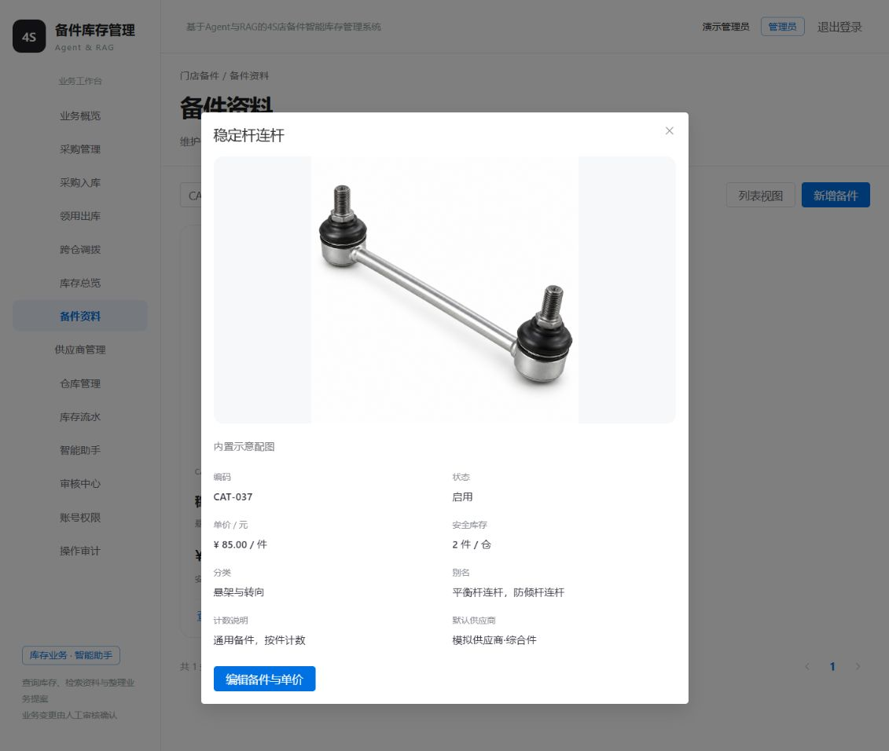
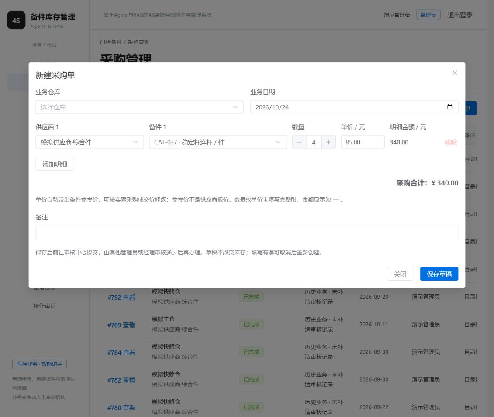
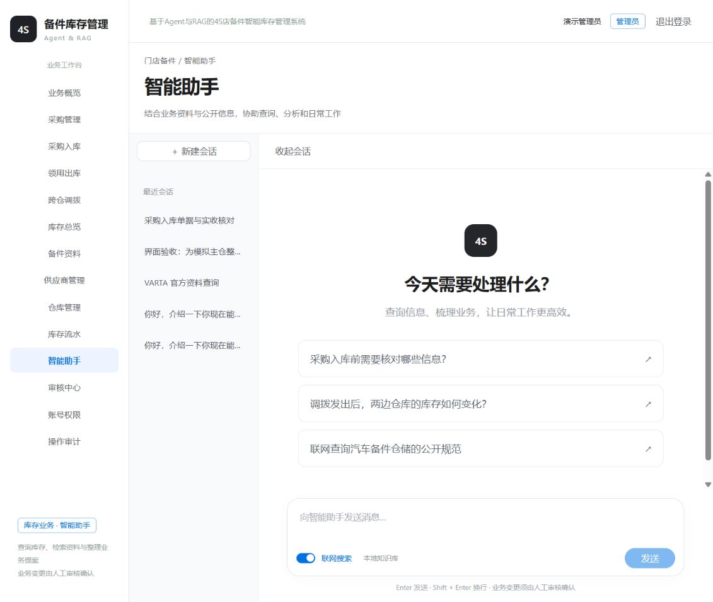

# 备件单价、采购金额与会话栏验证

日期：2026-10-26。范围仅为本次资料/采购展示及会话栏调整，未提交 Git。

## 已实现

- 备件卡片、列表、详情均显示单价，管理员可从详情的“编辑备件与单价”维护；零价显示待维护。价格按每个完整库存包装（件）计，不进行瓶/桶/套内部换算。
- 当前为通用部件目录，编辑与详情不再展示制造商、厂家件号、规格版本、来源版本及身份核准操作。已有后端字段、数据表及历史记录保留，编辑时保留未展示的旧字段；不要求补齐真实商品身份才能使用现阶段功能。
- 采购明细仍先选供应商再选其可供备件；选择备件带出参考单价，允许调整成交价，显示每行金额和整单合计。供应商切换清除原备件及价格，不沿用不匹配金额。未完成有效明细显示“—”。金额展示用整数分运算，业务金额仍由后端 Decimal 校验。
- 新建会话与收起会话使用相同高度的工具栏，并垂直居中。

## 缺失参考价维护

`data/catalog/parts-expansion.json` 升级为 `2026-10-26.1`，为 CAT-013 至 CAT-048 共36类登记模拟参考价，来源说明明确不是厂家报价、供应商承诺或市场实测价格。原有12类价格未调整。

显式运行 `.venv\Scripts\python.exe -X utf8 -m backend.configure_reference_prices`，仅允许项目开发库和专用开发账号。首次补齐36条、保留0条；再次运行补齐0条、保留36条。仅覆盖价格为0且 SKU/名称匹配的条目，不在应用启动时执行。修改前后值已写入被忽略的 `data/local-backups/reference-prices-*.json`，并记录业务审计。现有48类备件参考价均大于0。

没有修改采购历史单价、数量、库存或库存流水。对账仍为823张单据、1359条流水、96条余额，现有373件、调拨在途5件。

## 自动检查

以下检查均在本次修改后实际运行：

```powershell
.\.venv\Scripts\python.exe -X utf8 -m pytest tests/test_reference_prices.py tests/test_m1.py -q --tb=short
# 6 passed；真实隔离 MySQL 测试库，包括只补零价、保留非零、重放无新增审计、非法价格及无库存流水写入。
```

在 `frontend` 目录运行：

```powershell
& 'D:\DevTools\nodejs\node.exe' --test tests/purchaseAmounts.test.js
# 3 passed；小数精确计算、无效输入、多行及超安全整数范围合计。
& 'D:\DevTools\nodejs\npm.cmd' run build
# 构建成功；仍有既有的单包大于500kB提示。
```

## 实际页面核验

- CAT-037 稳定杆连杆：卡片、列表及详情均为85.00元/件；编辑入口单价为85.00，且无真实制造商/厂家件号/核准字段。打开后取消，未保存无关编辑。
- 重新加载资料后，采购选择“模拟供应商·综合件 → 稳定杆连杆”自动带出85.00；加减按钮与正常键盘输入验证3件255.00、4件340.00及6件510.00。自动填值工具未完整触发数量控件的原生 change 时曾出现显示不同步，不能将该模拟输入结果当作正常键盘路径；最终保留原有控件绑定，正常键盘与按钮路径一致。
- 空气滤清器自动68.00；人工调整单价0.10、数量3后金额0.30，多行合计及供应商切换清空已检查。
- 会话工具栏两按钮中心纵坐标均约239.8px，差小于0.01px。
- 页面验证仅操作未保存表单，未新增采购单或改变库存；最终返回备件资料。

截图：





本次未重新运行 RAG 固定评测，不将资料页/价格测试表述为 M3 或 M4 全面验收。
